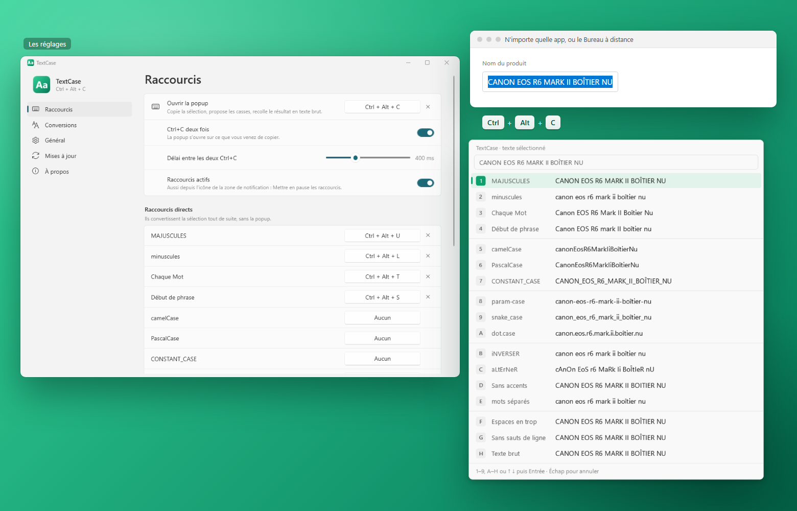

<p align="center">
  
</p>

<h1 align="center">TextCase</h1>

<p align="center">
  Change la casse du texte sélectionné dans n'importe quelle application Windows, même à travers le Bureau à
  distance : un raccourci, une popup, et le texte est recollé sans mise en forme.
</p>

<p align="center">
  <a href="README.md">English</a> · <b>Français</b>
</p>

<p align="center">
  <a href="https://apps.microsoft.com/detail/9N6FJCHCW5XW?referrer=appbadge&mode=direct"></a>
</p>

<p align="center">
  
</p>

---

> **Début du développement.** Version 0.2.

## Fonctionnalités

### Dans n'importe quelle application

- Sélectionnez du texte, faites **Ctrl + Alt + C** : une popup montre **le résultat de chaque casse** ; choisissez-en
  une (une touche, les flèches ou la souris) et la sélection est remplacée, en **texte brut**. Les quatre casses de
  base par défaut, les autres à cocher dans les réglages.
- Ou **Ctrl+C+C** (Ctrl maintenu, C deux fois), comme avec DeepL : la popup s'ouvre sur ce que vous venez de
  copier.
- **Raccourcis directs** : Ctrl + Alt + U, L, T, S convertissent tout de suite (MAJUSCULES, minuscules, Chaque Mot,
  Début de phrase) ; un par casse si vous voulez.
- Marche aussi dans la fenêtre du **Bureau à distance** (rien à installer sur le PC distant).
- Dans l'Explorateur : clic droit sur un fichier ou un dossier → **Changer la casse du nom** (Afficher d'autres
  options).
- Le presse-papiers retrouve ce que vous aviez copié.

### Les casses

- MAJUSCULES · minuscules · Chaque Mot · Début de phrase
- camelCase · PascalCase · CONSTANT_CASE · param-case · snake_case · dot.case
- iNVERSER · aLtErNeR · sans accents · mots séparés
- Nettoyage : espaces en trop, sauts de ligne, texte brut tel quel.

### Chaque Mot et Début de phrase intelligents

- « CANON EOS R6 MARK II » devient « Canon EOS R6 Mark II » : une **liste de mots gardés tels quels** (EOS, iPhone,
  mm…), que vous modifiez.
- Les mots avec des chiffres (R6, 24-70mm), les chiffres romains (Mark II), les mots en casse mixte (iPhone) et les
  sigles d'une phrase normale sont gardés.
- Les petits mots d'un titre restent en minuscule (de, la, of, the…).
- Un interrupteur **Intelligent** dans la popup (touche 0) : désactivé, chaque lettre change.

### Et aussi

- Apparence Windows 11 (Fluent, Mica), thème clair ou sombre.
- **Anglais et français**.
- **Démarre avec Windows**, attend dans la zone de notification, une pause en un clic.
- **Mises à jour en un clic** depuis l'application (GitHub Releases).
- **Mode développeur** (À propos) : un journal, et la popup reste ouverte pour une capture d'écran.

## Installation

Depuis le **Microsoft Store** : [Change Text Case](https://apps.microsoft.com/detail/9N6FJCHCW5XW?referrer=appbadge&mode=direct), signée par Microsoft, mise à jour par
le Store. Elle n'a pas le menu de l'Explorateur (une application du Store ne peut pas l'ajouter de cette façon).

Ou depuis GitHub :

1. Téléchargez `TextCase-Setup-x.y.z.exe` depuis la page [Releases](../../releases).
2. Lancez-le. L'installeur n'étant pas signé, Windows SmartScreen peut afficher « Windows a protégé votre ordinateur » :
   cliquez sur **Informations complémentaires → Exécuter quand même**.
3. Acceptez la demande d'administrateur (UAC).

L'installeur copie l'application dans `C:\Program Files\TextCase`, l'ajoute au menu Démarrer, et propose d'installer
le **.NET 10 Desktop Runtime** de Microsoft s'il est absent. À son premier lancement, l'application active *Démarrer
avec Windows*.

Désinstaller : **Paramètres → Applications → Applications installées → TextCase**.

**Configuration requise :** Windows 11 (Windows 10 2004 ou plus récent peut fonctionner), x64. Pour le Bureau à
distance, le copier-coller entre les deux PC doit marcher (le presse-papiers est partagé par défaut).

## Développement

### Prérequis

| Outil | Rôle | Installation |
|-------|------|--------------|
| **Git** | Récupérer le code | `winget install Git.Git` |
| **.NET 10 SDK** | Compiler l'application (C# / WPF) et lancer les tests | `winget install Microsoft.DotNet.SDK.10` |
| **Inno Setup 6** | Compiler l'installeur | `winget install JRSoftware.InnoSetup` |
| **Windows SDK** | `makeappx` et `makepri`, pour le paquet de la version Store | `winget install Microsoft.WindowsSDK.10.0.26100` |

### Compiler

```powershell
.\scripts\build.ps1
```

Le script lance les tests, puis écrit `dist\app\` (dépendant du framework, ReadyToRun) et
`dist\TextCase-Setup-<version>.exe`. Options : `-SkipTests`, `-NoInstaller`.

```powershell
.\scriptsuild-store.ps1
```

La version Microsoft Store : `dist\store\TextCase_<version>.0_x64.msix`, la même application avec .NET dedans, non
signée (le Store la signe). Le démarrage avec Windows y passe par une tâche de démarrage, le Store installe les mises
à jour, et l'Explorateur n'a pas le menu de TextCase (ce qu'un paquet écrit dans le registre reste dans sa copie).

### Pendant le développement

```powershell
dotnet test tests\TextCase.Tests        # tests unitaires
dotnet run --project src\TextCase       # lancer l'application (--background n'ouvre aucune fenêtre)
```

`TEXTCASE_LANG=en|fr` et `TEXTCASE_THEME=Light|Dark` imposent une langue ou un thème. TextCase ne tourne qu'une fois
par session : quittez-le depuis son icône de notification avant de lancer une autre version.

### Organisation du code

```
src/
  TextCase.Core/   Logique sans interface : les conversions et leurs règles, raccourcis, Ctrl+C deux fois, GitHub Releases
  TextCase/        Application WPF : hook clavier, copier-coller, presse-papiers, la popup, la fenêtre des réglages, mises à jour
installer/         Script Inno Setup
store/             Manifeste, logos et fiche du paquet Microsoft Store
scripts/           build.ps1, build-store.ps1, make-icons.ps1
tests/             Tests unitaires (xUnit)
```

### Traductions

Textes de l'application : `src/TextCase/Properties/Strings.resx` (anglais) et `Strings.fr.resx` (français) ; les
tests vérifient que les deux ont les mêmes clés et les mêmes paramètres. Messages de l'installeur :
`installer/TextCase.iss`.

### Icônes

`scripts\make-icons.ps1` dessine l'icône (`.ico`, le PNG 256 px de l'application, `docs/icon-256.png`,
`docs/icons/TextCase.svg`, les logos de `store/Assets`). Les fichiers générés sont dans le dépôt : relancez-le seulement pour changer le dessin.

### Publier une version

1. Mettez à jour `<Version>` dans `Directory.Build.props`.
2. Commitez, puis créez et poussez un tag : `git tag v0.1.0`, puis `git push origin v0.1.0`.
3. Le workflow GitHub Actions compile, teste et publie l'installeur dans une Release.
4. La version Store : `.\scriptsuild-store.ps1`, puis une nouvelle soumission dans le Partner Center avec le nouveau
   `.msix`.

## Confidentialité

Le texte que vous convertissez ne quitte jamais votre ordinateur : TextCase le lit dans le presse-papiers, le convertit
en mémoire et le recolle. Pour voir ses raccourcis, il observe le clavier, et n'en garde rien. En mode développeur
seulement (À propos), un journal des raccourcis et de chaque changement (durées et longueurs, jamais le texte) est
gardé dans `%LOCALAPPDATA%\TextCase\swap.log`. Le seul accès réseau est la **recherche de mises à jour** sur GitHub
(`api.github.com`), désactivable dans **Mises à jour** ; la version Microsoft Store n'en a aucun (le Store la met à
jour).

## Licence

[MIT](LICENSE.md).

## Crédits

Développé par [QuentinPerou](https://github.com/quentinperou), avec [Claude Code](https://claude.com/claude-code) (Anthropic).
Inspiré de l'extension Chrome *Change Case*.
