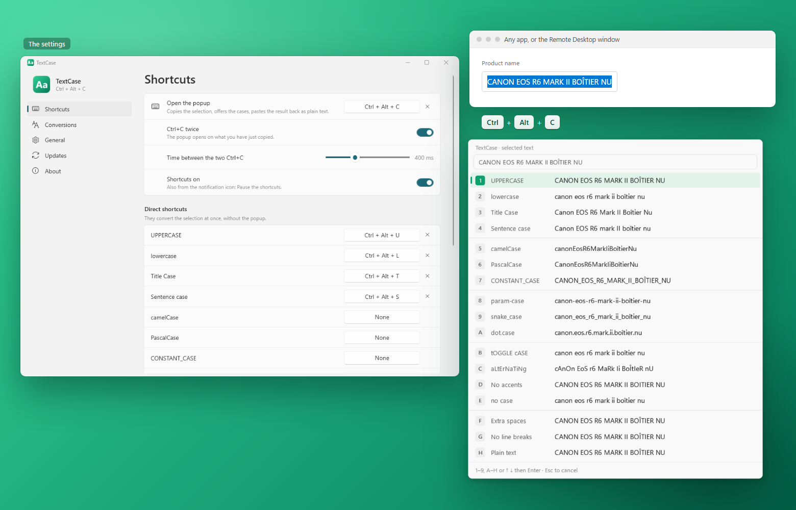

<p align="center">
  
</p>

<h1 align="center">TextCase</h1>

<p align="center">
  Change the case of the selected text in any Windows app, even through Remote Desktop: a shortcut, a popup, and the
  text is pasted back without formatting.
</p>

<p align="center">
  <b>English</b> · <a href="README.fr.md">Français</a>
</p>

<p align="center">
  
</p>

---

> **Early development.** Version 0.1, the first one.

## Features

### In any app

- Select some text, press **Ctrl + Alt + C**: a popup shows **the result of each case**; choose one (a key, the
  arrows or the mouse) and the selection is replaced, as **plain text**. The four basic cases by default, the
  others to tick in the settings.
- Or **Ctrl + C twice**, as with DeepL: the popup opens on what you have just copied.
- **Direct shortcuts**: Ctrl + Alt + U, L, T, S convert at once (UPPERCASE, lowercase, Title Case, Sentence case);
  one for each case if you like.
- Works in the **Remote Desktop** window too (nothing to install on the remote PC).
- The clipboard holds again what you had copied.

### The cases

- UPPERCASE · lowercase · Title Case · Sentence case
- camelCase · PascalCase · CONSTANT_CASE · param-case · snake_case · dot.case
- tOGGLE cASE · aLtErNaTiNg · no accents · no case
- Clean-ups: extra spaces, line breaks, plain text as it is.

### Smart Title Case and Sentence case

- "CANON EOS R6 MARK II" becomes "Canon EOS R6 Mark II": a **list of words kept as written** (EOS, iPhone, mm…),
  yours to edit.
- Words with digits (R6, 24-70mm), Roman numerals (Mark II), words in mixed case (iPhone) and acronyms in a normal
  sentence are kept.
- The small words of a title stay in lowercase (de, la, of, the…).
- A **Smart** switch in the popup (key 0): off, every letter changes.

### And also

- Windows 11 look (Fluent, Mica), light or dark theme.
- **English and French**.
- **Starts with Windows**, waits in the notification area, a pause in one click.
- **Updates in one click** from the app (GitHub Releases).
- **Developer mode** (About): a log, and the popup stays open for a screenshot.

## Installation

1. Download `TextCase-Setup-x.y.z.exe` from the [Releases](../../releases) page.
2. Run it. As the installer is not signed, Windows SmartScreen may show “Windows protected your PC”:
   click **More info → Run anyway**.
3. Accept the administrator prompt (UAC).

The installer copies the app to `C:\Program Files\TextCase`, adds it to the Start menu, and offers to install the
Microsoft **.NET 10 Desktop Runtime** if it is missing. At its first start the app turns on *Start with Windows*.

To uninstall: **Settings → Apps → Installed apps → TextCase**.

**Requirements:** Windows 11 (Windows 10 2004 or later may work), x64. For Remote Desktop, copy and paste between the
two PCs must work (the clipboard is shared by default).

## Development

### Prerequisites

| Tool | Purpose | Install |
|------|---------|---------|
| **Git** | Get the code | `winget install Git.Git` |
| **.NET 10 SDK** | Build the app (C# / WPF) and run the tests | `winget install Microsoft.DotNet.SDK.10` |
| **Inno Setup 6** | Build the installer | `winget install JRSoftware.InnoSetup` |

### Build

```powershell
.\scripts\build.ps1
```

The script runs the tests, then writes `dist\app\` (framework-dependent, ReadyToRun) and
`dist\TextCase-Setup-<version>.exe`. Options: `-SkipTests`, `-NoInstaller`.

### While developing

```powershell
dotnet test tests\TextCase.Tests        # unit tests
dotnet run --project src\TextCase       # run the app (--background opens no window)
```

`TEXTCASE_LANG=en|fr` and `TEXTCASE_THEME=Light|Dark` force a language or a theme. TextCase runs once per session:
quit it from its notification icon before starting another build.

### Code layout

```
src/
  TextCase.Core/   Logic without UI: the conversions and their rules, shortcuts, Ctrl+C twice, GitHub releases
  TextCase/        WPF app: keyboard hook, copy and paste, clipboard, the popup, the settings window, updates
installer/         Inno Setup script
scripts/           build.ps1, make-icons.ps1
tests/             Unit tests (xUnit)
```

### Translations

App texts: `src/TextCase/Properties/Strings.resx` (English) and `Strings.fr.resx` (French); the tests check that both
have the same keys and placeholders. Installer messages: `installer/TextCase.iss`.

### Icons

`scripts\make-icons.ps1` draws the icon (`.ico`, the 256 px PNG of the app, `docs/icon-256.png`,
`docs/icons/TextCase.svg`). The generated files are committed: run it again only to change the design.

### Releasing a version

1. Update `<Version>` in `Directory.Build.props`.
2. Commit, then create and push a tag: `git tag v0.1.0`, then `git push origin v0.1.0`.
3. The GitHub Actions workflow builds, tests and publishes the installer in a Release.

## Privacy

The text you convert never leaves your computer: TextCase reads it from the clipboard, converts it in memory and
pastes it back. To see its shortcuts it watches the keyboard, and keeps nothing of it. Only in developer mode
(About), a log of the shortcuts and of each change (times and lengths, never the text) is kept in
`%LOCALAPPDATA%\TextCase\swap.log`. The only network access is the **update check** on GitHub (`api.github.com`),
which can be turned off in **Updates**.

## License

[MIT](LICENSE.md).

## Credits

Developed by [QuentinPerou](https://github.com/quentinperou), with [Claude Code](https://claude.com/claude-code) (Anthropic).
Inspired by the Chrome extension *Change Case*.
